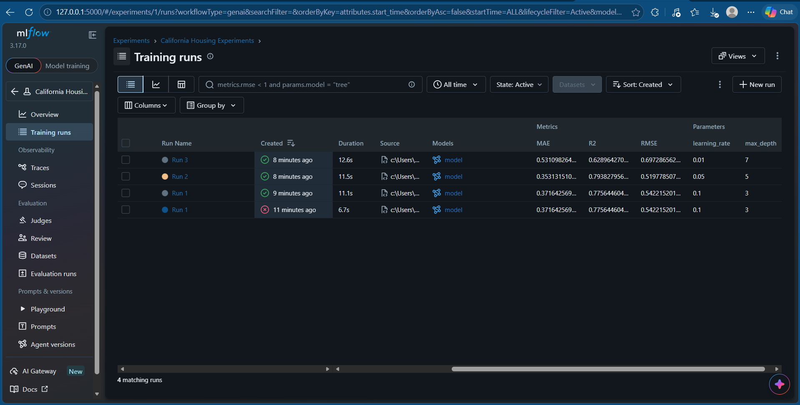

## Results

| Run | Max Depth | Learning Rate | RMSE | MAE | R² |
|---|---:|---:|---:|---:|---:|
| Run 1 | 3 | 0.1 | 0.5422 | 0.3716 | 0.7756 |
| Run 2 | 5 | 0.05 | 0.5198 | 0.3531 | 0.7938 |
| Run 3 | 7 | 0.01 | 0.6973 | 0.5311 | 0.6290 |

## Best Model

Run 2 is the best model because it has the lowest RMSE (0.5198) and the highest R² (0.7938) among the three runs.

## Conclusion

MLflow helped track and compare the three experiments. Run 2 performed best on the validation dataset.

## MLflow Screenshot

